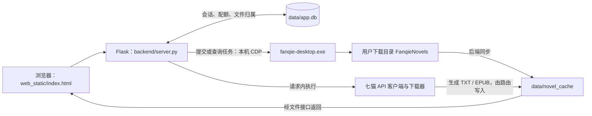

# novelmy 项目导读

这是一个在 Windows 上运行的多用户小说下载站。浏览器里番茄和七猫的操作相似，但后端判定「下载完成」的时机不同：番茄先拿到任务，再等文件；七猫在同一次 HTTP 请求里生成文件。两者最后都进入用户的「我的文件」。

## 代码入口

- [server.py](../server.py) 保留原启动命令；路由、配额和文件处理在 [backend/server.py](../backend/server.py)。
- [frontend/src/pages/](../frontend/src/pages/) 放新版页面，[components/](../frontend/src/components/) 放复用组件，[api/](../frontend/src/api/) 管理请求，[styles/](../frontend/src/styles/) 放样式。[web_static/](../web_static/) 是纯构建目录：Git 不保存它，`start.bat` 每次启动前由 Vite 重新生成，勿在其中存放手写资源。
- [tests/](../tests/) 放隔离 Flask 服务、接口与浏览器联调；[frontend/test/](../frontend/test/) 放不依赖 Flask 的前端测试。

## 从页面到文件

## 顺着一次番茄下载读源码

1. 从 [SourceShelf.vue](../frontend/src/pages/SourceShelf.vue) 的下载确认进入 [library.js](../frontend/src/api/library.js) 的 `download()`，跟踪任务提交和 `/api/jobs` 的轮询。拿到 `job_id` 意味着桌面程序接受了任务，不代表已有文件可下载。
2. 在 [backend/server.py](../backend/server.py) `api_download()` → `_check_user_download_state()`：前者查配额、创建任务；后者区分当前用户已有的完成记录、未完成占位和桌面端正在运行的任务。判断重复扣次的问题从这里开始。
3. 文件未出现在列表时，分开查三处：桌面程序是否已写到 `%USERPROFILE%\Downloads\FanqieNovels`，`sync_files_to_web()` 是否已将文件复制到 Web 目录，当前用户的 `downloads` 记录是否仍为零字节占位。`_verify_download_job()` 是后端校验入口，`api_finish_download()` 是前端通知的接收端。
4. 对照 `qimao_download_start()`：七猫处理函数等待 `QimaoBookDownloader.download_book()` 返回文件内容，写盘、更新数据库后才返回成功。排查七猫请求缓慢应看这一调用，而不是桌面任务队列。

## 按改动定位

| 要改什么 | 先读哪里 |
|---|---|
| 下载格式、章节拼装 | 七猫读 [qimao_downloader.py](../backend/qimao_downloader.py)；番茄读 `api_download()` 传给桌面程序的参数 |
| 登录、卡密或下载次数 | [backend/server.py](../backend/server.py) 的 `init_db()`、`current_user()`、`card_redeem()`，再看两条下载路径各自的扣次时机 |
| 我的文件、下载链接 | `api_files()` 负责用户列表；前端根据 `source` 选择番茄或七猫的文件接口 |
| 分卷进度或数量限制 | `novels_split_start()` → `_do_split()` → `novels_split_status()`；服务重启后内存中的任务 ID 失效 |
| 页面交互或移动端样式 | 新版从 [Vue 页面](../frontend/src/pages/) 和 [样式](../frontend/src/styles/) 入手；改完后重新构建首页，不手改生成的 HTML |

启动命令、端口和测试工具现状见 [AGENTS.md](../AGENTS.md#运行与验证)。
